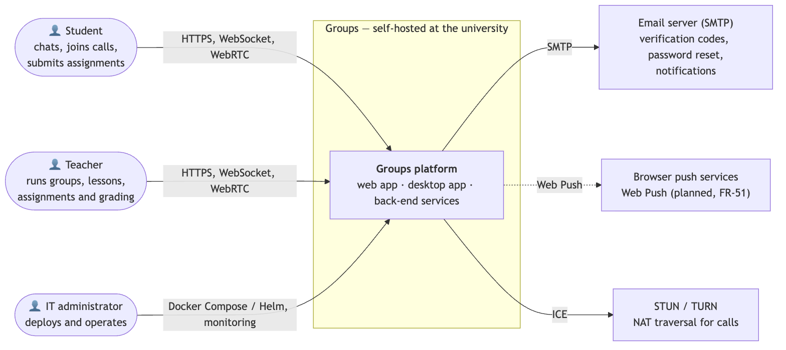
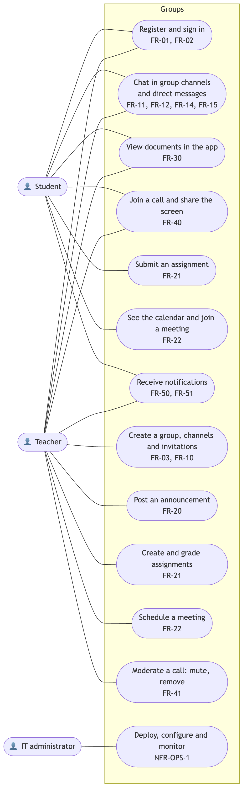
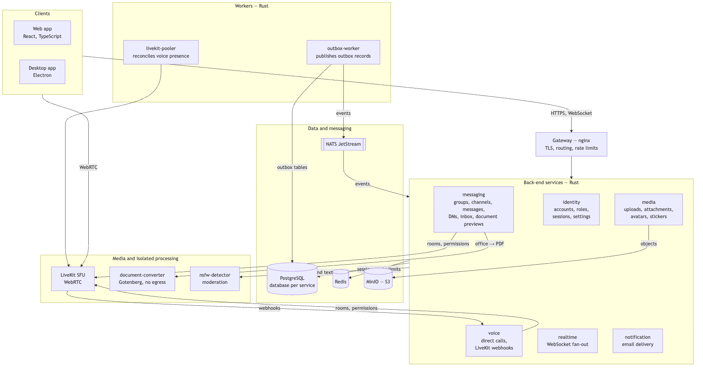
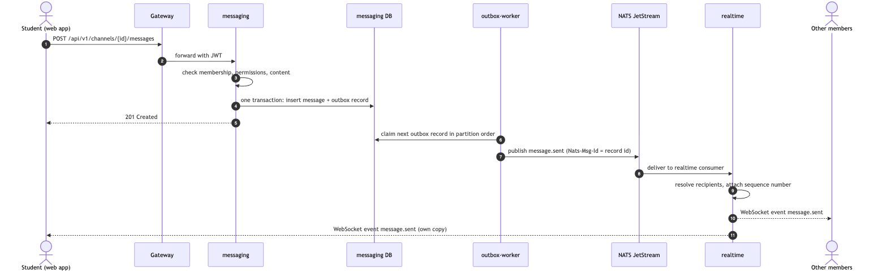

# 7. Architecture and diagrams

Diagram sources are plain-text [Mermaid](https://mermaid.js.org) files (`*.mmd`) in [`diagrams/`](diagrams). They render on GitHub and can be edited in any text editor or in the Mermaid Live Editor. The SVG and PNG exports next to them are produced with:

```bash
npx -y @mermaid-js/mermaid-cli -i docs/diagrams/components.mmd -o docs/diagrams/components.svg -b white
```

## 1. System context



Source: [`diagrams/system-context.mmd`](diagrams/system-context.mmd)

Groups is deployed on the university's own infrastructure. Three kinds of people use it:

- **Students and teachers** reach it over HTTPS and WebSocket for the application, and over WebRTC for calls.
- **The IT administrator** deploys it with Docker Compose or Helm and monitors it.

External dependencies:

- **SMTP server** — verification codes, password reset and notification emails.
- **STUN/TURN** — call connectivity behind NAT.
- **Browser push services** — Web Push for the planned push notifications (FR-51).

No third-party cloud service stores user data (NFR-PRIV-1).

## 2. Use cases



Source: [`diagrams/use-cases.mmd`](diagrams/use-cases.mmd)

Each use case is labelled with the requirements it covers in [`06-requirements.md`](06-requirements.md). Teachers have every student use case plus group management, announcements, assignment grading, meeting scheduling and call moderation.

## 3. Components (draft)



Source: [`diagrams/components.mmd`](diagrams/components.mmd)

| Component | Responsibility | Requirements | Storage |
|---|---|---|---|
| **Web app / Desktop app** | React and TypeScript user interface; Electron wraps the same build for Windows, macOS and Linux | all user-facing FR, NFR-COMP-1 | browser storage for preferences only |
| **Gateway** (nginx) | TLS termination, routing by path to services, request rate limits, WebSocket upgrade | NFR-SEC-1, NFR-SEC-4 | — |
| **identity** | accounts, student and teacher roles, verification, sessions and token revocation, settings, presence preferences | FR-01..03, FR-52 | PostgreSQL `identity`, Redis |
| **messaging** | groups, channels, roles, invitations, channel and direct messages, reactions, threads, pins, read state, inbox, document previews, voice-channel membership and moderation | FR-10..18, FR-20..25, FR-30, FR-41, FR-50 | PostgreSQL `messaging` |
| **media** | uploads, attachments, avatars, stickers, storage quotas and cleanup | FR-11, FR-24, FR-30 | PostgreSQL `media`, MinIO |
| **voice** | direct calls, LiveKit webhooks, stream quality limits | FR-40, FR-41 | PostgreSQL `voice` |
| **realtime** | WebSocket connections; consumes events and delivers them to the right users with per-conversation sequence numbers | NFR-PERF-1, NFR-REL-1 | PostgreSQL `realtime` (projections), Redis |
| **notification** | email delivery (verification, password reset, reminders) | FR-01, FR-02, FR-51 | — |
| **outbox-worker** | reads outbox tables and publishes events to NATS JetStream in partition order | NFR-REL-1 | PostgreSQL |
| **livekit-pooler** | reconciles voice-channel presence with the rooms actually open in LiveKit | FR-40 | — |
| **LiveKit SFU** | forwards WebRTC media between call participants | FR-40, NFR-PERF-3 | — |
| **document-converter** | converts office files to PDF in a sandbox with no network egress | FR-30, NFR-SEC-2 | temporary files only |
| **nsfw-detector** | image and text moderation | NFR-SEC-4 | — |

### Inside each service

Every Rust service follows the same layering, enforced by crate boundaries:

- **domain** — entities, value objects and business rules. No I/O.
- **core** — use cases and the ports (traits) they need.
- **infrastructure** — adapters that implement the ports: PostgreSQL repositories, NATS consumers, HTTP clients to other services, LiveKit and S3 clients.
- **api** — thin HTTP handlers and wiring.

Shared crates in [`backend/libs`](../backend/libs) hold the shared kernel (identifiers, pagination), published event contracts, common ports and infrastructure helpers (outbox, NATS runner, health checks).

## 4. Key scenario: sending a message



Source: [`diagrams/message-sequence.mmd`](diagrams/message-sequence.mmd)

The message and its event are written in **one database transaction** (transactional outbox). The outbox worker publishes events in order per conversation and de-duplicates them by record id. The realtime service attaches a sequence number per conversation, so a client detects a gap after a reconnect and reloads. This is how NFR-REL-1 is met without distributed transactions.

## 5. Data

- **One PostgreSQL database per service.** A service never reads another service's tables. Data it needs from another context arrives as events and is kept in a local projection, for example user names in messaging.
- **Files** are stored in MinIO under keys owned by the media service. Derived files (thumbnails, PDF previews) live next to the original and are deleted with it.
- **Events** are versioned contracts in [`backend/libs/contracts`](../backend/libs/contracts).

## 6. Deployment

- **One server:** [`docker-compose.yml`](../docker-compose.yml) starts every component, including PostgreSQL, NATS, Redis, MinIO and LiveKit.
- **Cluster:** the Helm chart in [`deploy/helm`](../deploy/helm) adds autoscaling, pod disruption budgets, network policies (for example, only messaging may reach the document converter) and health probes. Terraform environments in [`deploy/terraform`](../deploy/terraform) provision a local kind cluster or a cloud cluster.

## 7. Architectural decisions

Technology choices and their alternatives are in [`05-technology-comparison.md`](05-technology-comparison.md). The main decisions:

| Decision | Reason |
|---|---|
| Services split by bounded context, database per service | Independent deployment and scaling; failures stay inside one context |
| Transactional outbox + NATS JetStream | No lost events without distributed transactions (NFR-REL-1) |
| SFU (LiveKit) for media | Scales calls to a class size, with server-side moderation (FR-41, NFR-PERF-3) |
| Sandboxed converter for documents | Untrusted office files never reach the user's browser or a service with network access (NFR-SEC-2) |
| One codebase for web and desktop | The same features ship on every platform (NFR-COMP-1) |
