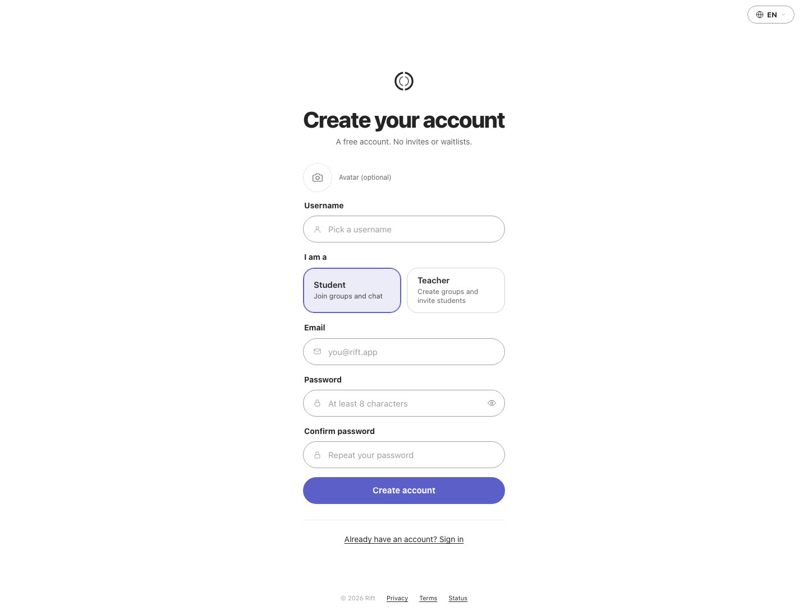
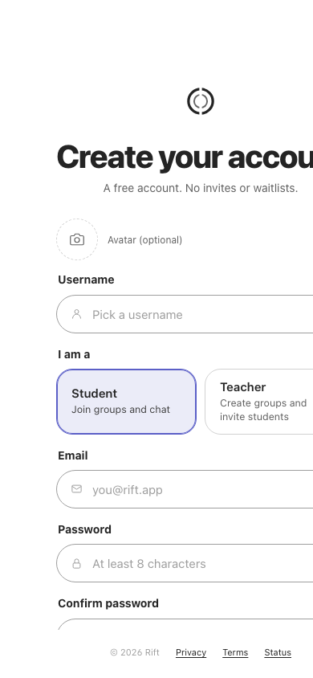
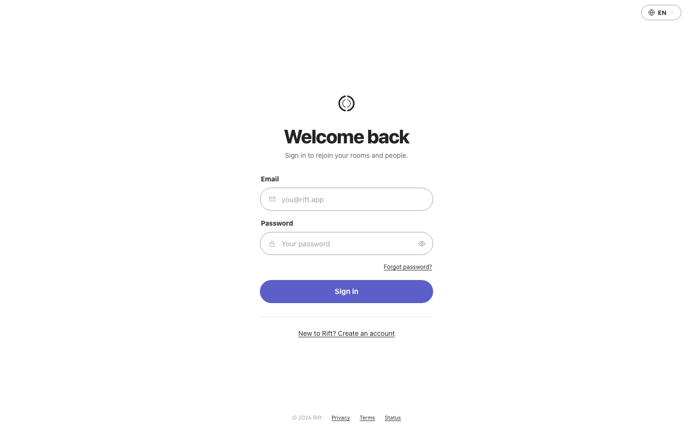
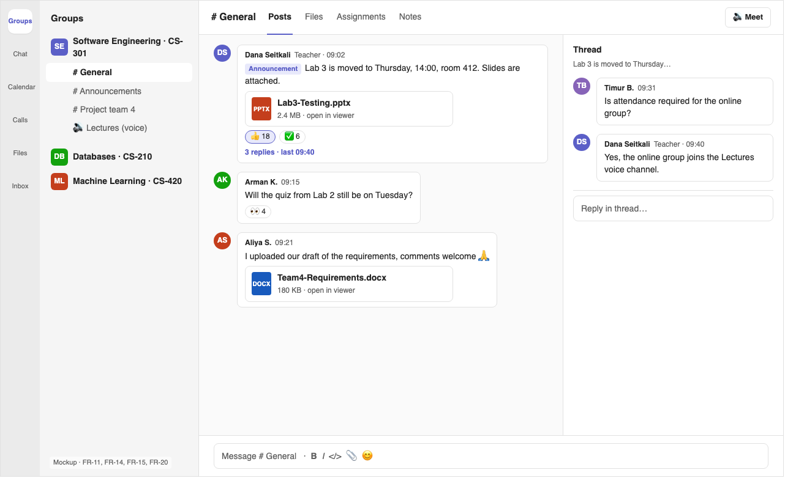
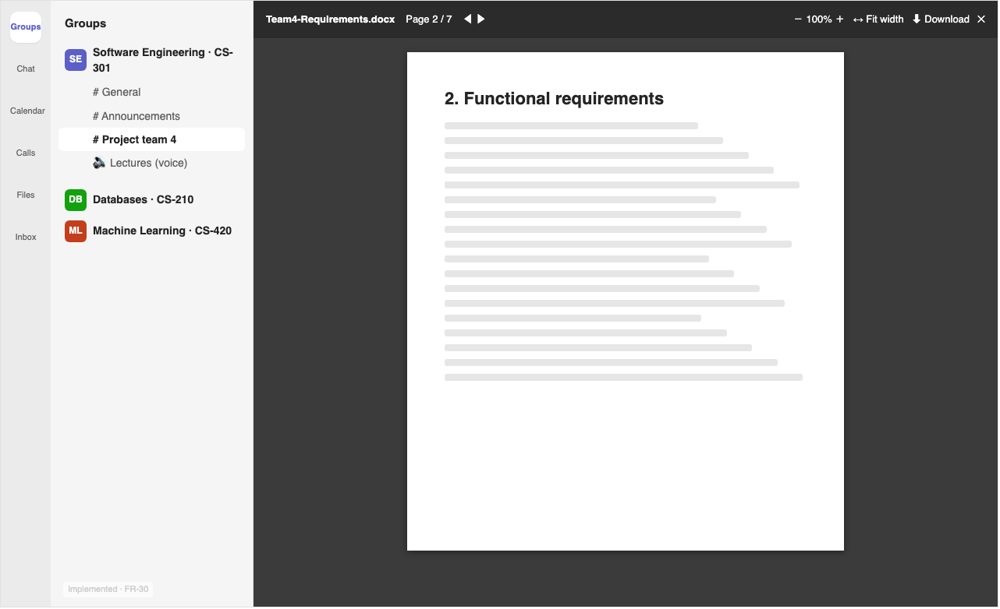
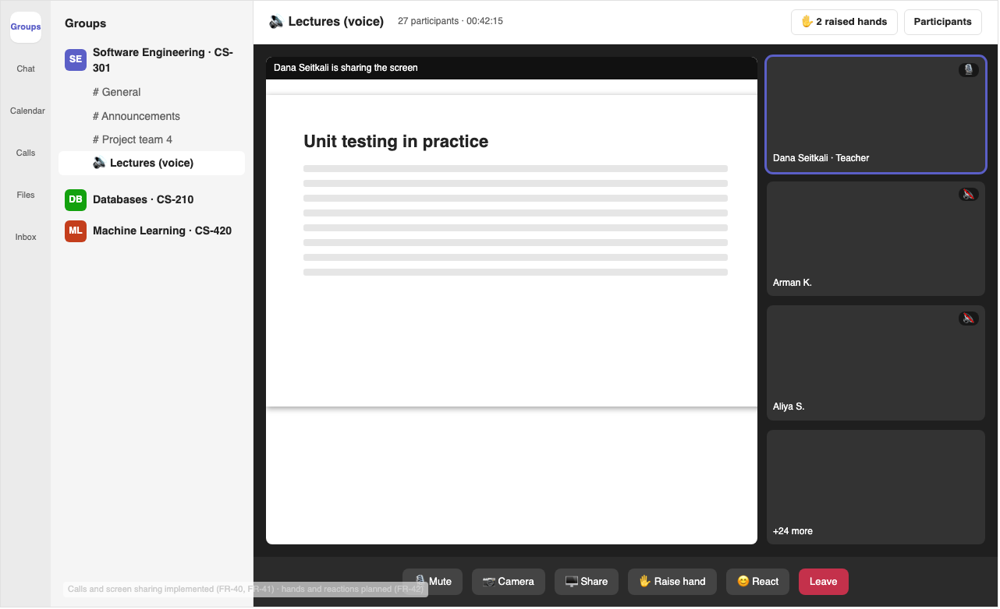
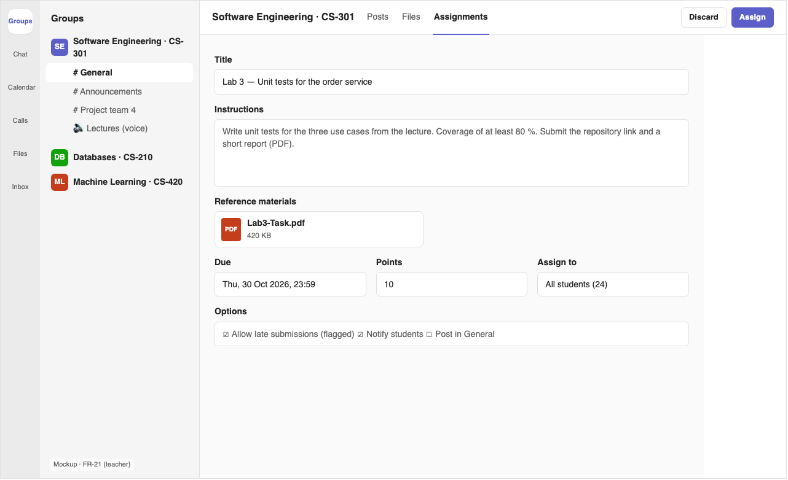
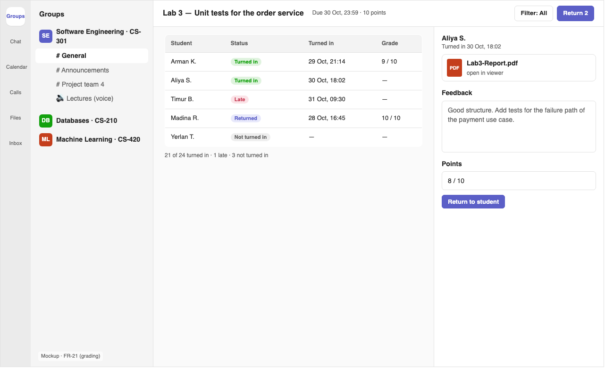
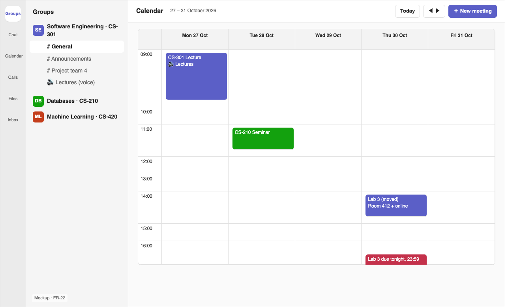

# 8. UX and prototype

Two kinds of material:

- **Screens of the running application.** Features already implemented, captured from a local deployment.
- **Mockups of planned scenarios.** Clickable HTML in [`prototype/mockups/index.html`](prototype/mockups/index.html), opened in a browser with `#chat`, `#viewer`, `#call`, `#assignment`, `#grading` or `#calendar` after the file name. PNG exports sit next to it. The mockups use the visual language of the real app (left rail, group list, purple accent), so the gap between design and implementation stays small.

Each screen lists the requirements it covers in [`06-requirements.md`](06-requirements.md). The interview guide in [`02-relevance-evidence.md`](02-relevance-evidence.md) shows these screens to participants and records their feedback.

## Key scenarios

| # | Scenario | Actor | Screens | Requirements |
|---|---|---|---|---|
| 1 | Create an account and choose the role | Student, teacher | Sign-up, sign-in | FR-01, FR-02 |
| 2 | Discuss in a group channel: announcement, reactions, thread, shared files | Student, teacher | Channel chat | FR-11, FR-14, FR-15, FR-20 |
| 3 | Read a shared document without downloading it | Student, teacher | Document viewer | FR-30 |
| 4 | Give an online lesson with screen sharing | Teacher, students | Lesson call | FR-40, FR-41, FR-42 |
| 5 | Publish an assignment | Teacher | Create assignment | FR-21 |
| 6 | Review and grade submissions | Teacher | Grading | FR-21 |
| 7 | See the week's lessons and deadlines | Student | Calendar | FR-22 |

## 1. Create an account and choose the role — implemented

| Sign-up (desktop) | Sign-up (mobile, 390 px) |
|---|---|
|  |  |

The role is chosen with two cards: a **student** joins groups, a **teacher** creates groups and invites students. After the form, the user confirms the email with a six-digit code.

## 2. Group channel — mockup of the planned threads and reactions

A teacher's announcement carries slides that open in the viewer. Students react and ask follow-up questions in a thread on the right, so the main channel stays readable. The tabs Posts, Files, Assignments and Notes keep everything for the class in one place (H1, H2).

## 3. Document viewer — implemented

PDF, Word, PowerPoint, Excel, CSV, JSON and text files open in the app, with pages, zoom, fit width and download (H3). The screen is a mockup of the layout; the feature itself is implemented (issue [#21](https://github.com/azarenkov/groups/issues/21), PR [#62](https://github.com/azarenkov/groups/pull/62)).

## 4. Online lesson — calls implemented, meeting controls planned

The teacher shares the screen, and the active speaker is highlighted. Students can join with the camera off, which follows the evidence on camera reluctance in [`03-literature-review.md`](03-literature-review.md#33-video-meetings-in-education). Raise hand and in-call reactions are planned (FR-42).

## 5–6. Assignments — mockups

| Create assignment (teacher) | Review and grade (teacher) |
|---|---|
|  |  |

The teacher sets instructions, files, due date, points and audience. The review list shows status per student: turned in, late, returned or not turned in. Feedback and grade are returned in one step. Students see only their own submission (FR-21).

## 7. Calendar — mockup

Lessons, moved labs and assignment deadlines appear in one week view. Joining a meeting from the calendar opens the call (FR-22).

## Interaction with external systems

Groups has no public API for third parties at this stage. Internally, services exchange versioned events — for example `user.renamed` and `message.sent` in [`backend/libs/contracts`](../backend/libs/contracts) — and a REST API that the clients use.
